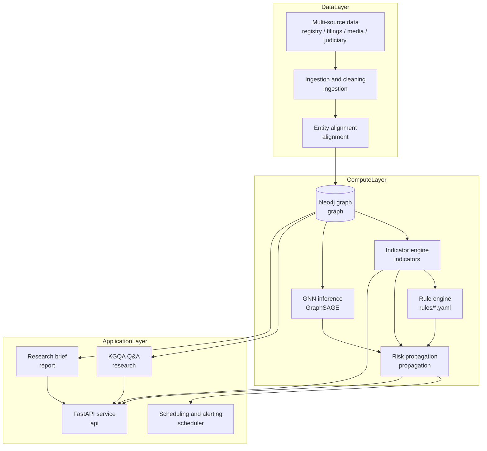

# fin-kg-risk-engine


> Document language: [中文](README.md) | English

> 金融知识图谱风险预警与智能投研系统
> Financial knowledge graph risk alerting and intelligent investment research.
> Enterprise-grade Python implementation: knowledge graph + rule engine + graph neural network + natural-language research Q&A.

Two problems, one system that runs, is testable and is explainable: "ownership relationships are so tangled that underlying risk cannot be seen through" and "investment research analysts spend 80% of their time collecting data instead of analysing it".

---

## Table of contents

- [What problem it solves](#what-problem-it-solves)
- [Real output](#real-output)
- [Architecture](#architecture)
- [Knowledge graph data model](#knowledge-graph-data-model)
- [Risk scoring and propagation](#risk-scoring-and-propagation)
- [5-minute quick start](#5-minute-quick-start)
- [One-command Docker deployment](#option-two-docker-compose-the-full-stack)
- [API reference](#api-reference)
- [Project layout](#project-layout)
- [Development and testing](#development-and-testing)
- [Architecture decision records](#architecture-decision-records)
- [What it can and cannot do](#what-it-can-and-cannot-do)
- [License and contribution](#license-and-contribution)

---

## What problem it solves

**Problem one: seeing risk through.** When one entity gets into trouble, those truly affected are rarely only itself — they are the entire chain it guarantees, holds equity in, or controls. Most risk systems on the market tell you "this company has 3 lawsuits" rather than "if this company falls, who else goes down with it".

The answer this system gives:

```
华信控股集团有限公司 -[GUARANTEE]-> 华信置业发展有限公司
                     -[GUARANTEE]-> 华信供应链管理有限公司
                     -[GUARANTEE]-> 中信创业投资有限公司
```

Every path carries a propagated score and a bottleneck coefficient, so the analyst knows which link to look at.

**Problem two: research efficiency.** When an analyst opens a target company, they have to look up the shareholding at the company registry (工商登记), then the guarantees in the filings, then the litigation on China Judgments Online (中国裁判文书网), then the adverse media in the news — 80% of the time goes into collecting and tidying data.

This system organises "entity profile / ownership structure / guarantee chain / risk profile / risk propagation / risk events / comparable cases / points to watch" into one structured brief, and **every number can be traced back to a specific node and relation in the graph**.

---

## Real output

The output below is actually produced by the code in this repository; it needs neither a database nor an API key:

```text
$ fin-kg seed --companies 40 && fin-kg score --limit 5

  42.00  medium   合成28号制造业有限公司
  28.25  low      合成11号建筑工程有限公司
  22.00  low      合成10号贸易有限公司
  12.75  low      合成23号贸易有限公司
   8.25  low      合成12号制造业有限公司

$ fin-kg ingest --source csv && fin-kg ask "华信控股集团有限公司的担保链"

华信控股集团有限公司 共有 7 条担保传导路径，最长 3 跳。示例：华信控股集团有限公司 -> 华信置业发展有限公司（1 跳）；华信控股集团有限公司 -> 华信置业发展有限公司 -> 华信供应链管理有限公司（2 跳）；华信控股集团有限公司 -> 华信置业发展有限公司 -> 华信供应链管理有限公司 -> 中信创业投资有限公司（3 跳）；华信控股集团有限公司 -> 华信置业发展有限公司 -> 恒基建筑工程有限公司（2 跳）；华信控股集团有限公司 -> 华信置业发展有限公司 -> 恒基建筑工程有限公司 -> 远达物流有限公司（3 跳）。

[意图] guarantee_chain  [置信度] 0.90
  · 担保链路径
```

The composition of a risk score is transparent as well — it is not a black-box number:

```text
$ fin-kg report <entity-id>

## 风险画像
恒基建筑工程有限公司 风险分 28.5（medium）。主要来源：强制执行金额占注册资本比 85分×权重0.15（贡献12.8）；对外担保余额占注册资本比 50分×权重0.20（贡献10.0）。

- 涉诉事件数：25 分（权重 0.15，贡献 3.8）
- 强制执行金额占注册资本比：85 分（权重 0.15，贡献 12.8）
- 对外担保余额占注册资本比：50 分（权重 0.20，贡献 10.0）
- 担保链深度：20 分（权重 0.10，贡献 2.0）
```

**An honest caveat:** the above uses the **synthetic sample data** in this repository (`data/samples/`); all entity names are fictional. The sample data demonstrates the pipeline — it is not real market data. Real business data has to be ingested by you (from company registry, filings, court judgments and other public or licensed sources).

---

## Architecture



**Five layers, dependencies point inwards only:**

| Layer | Modules | Responsibility |
|---|---|---|
| `domain` | entities / relations / indicators / risk / provenance | Pure Pydantic, zero I/O |
| `graph` | schema / repository / alignment / Cypher library | Graph storage abstraction and entity normalisation |
| `ingestion` | source adapters / cleaning / ETL | Multi-source data → standardised records |
| `risk` | indicators / scoring / rules / propagation / GNN | The whole risk computation chain |
| `research` | KGQA / comparable cases / briefs | Investment research support |
| `api` `scheduler` `observability` | HTTP / scheduling / monitoring | Delivery and operations |

Every layer has a matching ADR explaining why it is cut that way.

---

## Knowledge graph data model

### Node types

| Label | Key properties | Description |
|---|---|---|
| `:Company` | `id` `name` `creditCode` `regCapital` `industry` `status` `foundedDate` `region` `riskScore` `riskLevel` | The risk anchor; registered capital is uniformly in **万元 (10k CNY)** |
| `:Person` | `id` `name` `role` `riskScore` `riskLevel` | Legal representative / director / actual controller |
| `:Event` | `id` `eventType` `severity` `occurredDate` `amount` `court` `caseNumber` `description` | Litigation / enforcement / penalty / rating downgrade and so on |
| `:Product` | `id` `productType` `issuerId` `amount` `issueDate` `maturityDate` `couponRate` `rating` | Bonds / funds / ABS and so on |

### Relation types

| Type | Direction | Required property | Transmissibility |
|---|---|---|---|
| `HOLD` | Company → Company | `percent` | 0.90 |
| `GUARANTEE` | Company → Company | `guaranteed_amount` | 1.00 |
| `CONTROLS` | Company → Company | — | 0.95 |
| `LEGAL_REP` | Person → Company | — | 0.80 |
| `DIRECTOR_OF` | Person → Company | — | 0.70 |
| `EMPLOYEE_OF` | Person → Company | — | 0.50 |
| `INVESTED_IN` | Company → Company | — | 0.60 |
| `MERGER_OF` | Company → Company | — | 0.75 |
| `SUPPLIER_OF` / `CUSTOMER_OF` | Company → Company | — | 0.40 |
| `RELATED` | Company → Company | — | 0.30 |
| `INVOLVED_IN` | Company → Event | — | 0.00 |
| `ISSUE` | Company → Product | — | 0.20 |

> The transmissibility is the strength with which risk propagates along that edge, and at the same time the anchor of explainability: the weakest link on a path is where the analyst should look. See the full definition in [`RELATION_SCHEMA`](src/fin_kg/domain/relations.py).

### Provenance

**Every node and relation carries provenance** — this is not an optional field:

```json
{
  "sourceType": "registry",
  "sourceId": "csv:companies",
  "recordId": "C001",
  "extractionMethod": "csv_import",
  "confidence": 1.0,
  "retrievedAt": "2026-11-08T10:20:50+08:00",
  "validTime": "2008-03-18",
  "provenanceHash": "9f2c1a7b4d3e8f6051a2b3c4d5e6f708"
}
```

- `confidence` describes the confidence of the **extraction**, not the authority of the source — manual entry and LLM extraction need different thresholds.
- `retrievedAt` and `validTime` form a bitemporal model: when the platform learned it versus when the fact holds true.
- Synthetic data always has `sourceType` of `synthetic` and `confidence` of 0.5, so **it can never be mistaken for real data**.

### Index strategy

| Type | Object | Purpose |
|---|---|---|
| UNIQUE constraint | `Company.id` / `Person.id` / `Event.id` / `Product.id` / `Entity.id` | Idempotent writes |
| UNIQUE constraint | `Company.creditCode` | Entity alignment anchor, preventing one legal entity from having several nodes |
| RANGE index | `HOLD.percent` / `GUARANTEE.guaranteed_amount` | Propagation and exposure aggregation |
| RANGE index | `Event.occurredDate` / `Event.eventType` | Indicator window scans |
| TEXT index | `Company.name` / `Person.name` / `Product.name` | Name lookup |
| RANGE index | `Company.riskScore` / `Company.industry` | Ranking and filtering |

The migration scripts live in [`migrations/`](migrations/) and are applied idempotently by `fin-kg migrate`.

---

## Risk scoring and propagation

### 10 risk indicators

| ID | Name | Dimension | Weight | Direction |
|---|---|---|---|---|
| `IND-LIT-001` | Number of litigation events | Judicial & compliance | 0.15 | Higher is riskier |
| `IND-ENF-001` | Enforcement amount as a ratio of registered capital | Judicial & compliance | 0.15 | Higher is riskier |
| `IND-PEN-001` | Number of administrative penalties | Judicial & compliance | 0.10 | Higher is riskier |
| `IND-GUA-001` | Outstanding external guarantees as a ratio of registered capital | Financial | 0.20 | Higher is riskier |
| `IND-DEF-001` | Number of default events | Financial | 0.05 | Higher is riskier |
| `IND-CHN-001` | Guarantee chain depth | Propagation | 0.10 | Higher is riskier |
| `IND-HLD-001` | Ownership concentration | Governance | 0.10 | **Lower is riskier** |
| `IND-CTL-001` | Actual controller risk | Governance | 0.05 | Higher is riskier |
| `IND-RTE-001` | Number of rating downgrades | Market | 0.05 | Higher is riskier |
| `IND-NEG-001` | Adverse media intensity | Market | 0.05 | Higher is riskier |

Composite score: `score = Σ(sub_score × weight) / Σ(weight)`. The denominator uses the actual sum of weights, so adding or removing an indicator does not make the magnitude of the score jump.

### Rule engine

Rules are **YAML**, so risk analysts can adjust them without touching Python:

```yaml
- id: R-CHAIN-001
  name: 担保链传导预警
  severity: critical
  condition:
    all:
      - indicator: IND-CHN-001
        operator: gte
        value: 2
      - path:
          relation_types: [GUARANTEE]
          min_hops: 2
          min_paths: 1
  message: "{entity} 处于多层担保链中（{path_count} 条传导路径），最大受影响方：{path_summary}"
```

The operators `gte / gt / lte / lt / eq / neq / between / in` are supported, the condition semantics are AND, and **every matching rule fires** (not just the first match).

The example above is quoted verbatim from `rules/risk_rules.yaml`; its rule names and message templates are maintained in Chinese by the risk team, so the `name` and `message` values are left untranslated here.

### Risk propagation

```
propagated(path) = source_score × Π(transmissibility_i) × decay^(hops-1)
```

The default `decay` is 0.6, with a hard cap of 3 hops. Multiplicative decay guarantees that longer paths score lower, and **the path itself is the evidence for the alert**.

### GNN

GraphSAGE node classification, **fully implemented in NumPy** (forward + backward + class-weighted loss), so training and inference work without torch. CI therefore needs no hundreds of megabytes of dependencies, and the training loop is genuinely covered by unit tests.

Labels can come from three sources: weak supervision (derived backwards from the rule engine), public datasets, or a manual CSV.

```bash
# Train (labels are generated by weak supervision from the rule engine by default)
fin-kg gnn train --model-path data/models/graphsage.json

# Train with labels from a CSV
fin-kg gnn train --labels data/labels.csv --model-path data/models/graphsage.json

# Load the model and inspect the model score
fin-kg gnn load --model-path data/models/graphsage.json

# Inspect the model status
fin-kg gnn status
```

After training, the risk score response gives **two scores at once** (see [ADR-0004](docs/adr/ADR-0004-risk-scoring-model.md)):

```json
{
  "score": 37.25,        // Baseline score: the weighted indicator composite; rule thresholds are judged against this
  "modelScore": 37.67,   // Model score: graph structure signal; null when no model is trained (not 0)
  "scoreGap": 0.42       // The difference between the two; a large gap means the graph structure says something the indicators do not
}
```

The model score does **not** take part in rule threshold decisions — a fused number is not explainable and a risk team would refuse to use it. The two scores are emitted side by side, so the model acts as an independent signal for human review.

### Performance

The scoring path is O(number of companies). Scoring all 5000 companies takes about 340ms; extrapolated, 100 000 companies take about 7 seconds. Two measures bring that down:

- **`?candidates=N`** — only the N candidates with the highest stored risk score are re-scored. Measured at **a 14× speed-up with an identical top-5** (the stored score was itself written back by the previous run of the very same computation). Without the parameter the full scoring runs and the ranking is most accurate.
- **Bulk write-back** — the risk scores are written back to the graph in one go, rather than one query per entity.

```bash
curl "http://localhost:8000/api/v1/risk/rank?limit=20&candidates=500"
```

---

## 5-minute quick start

### Option one: zero dependencies (30 seconds)

```bash
git clone https://github.com/Nephets1010/fin-kg-risk-engine.git
cd fin-kg-risk-engine

python -m venv .venv && source .venv/bin/activate    # Windows: .venv\Scripts\activate
pip install -e ".[dev]"

# Run the whole chain on synthetic data, no database needed
fin-kg seed --companies 40
fin-kg score --limit 10
fin-kg ingest --source csv          # load the sample dataset shipped in the repository
fin-kg ask "华信控股集团有限公司的担保链"
fin-kg rules
fin-kg schema
```

> Without Neo4j the platform stores the graph in `data/local-graph.json` (a readable JSON snapshot),
> so **data is shared across multiple CLI commands**. This is not a production store; it exists only for the local zero-dependency experience.

### Option two: Docker Compose (the full stack)

```bash
cp .env.example .env
# Edit .env and at least set FIN_KG_NEO4J_PASSWORD

docker compose up -d --build
docker compose exec api fin-kg migrate
docker compose exec api fin-kg ingest --source csv

open http://localhost:8000/docs        # interactive API documentation
open http://localhost:7474              # Neo4j browser
```

### Option three: local development

```bash
cp .env.example .env
# Start Neo4j and Redis (docker compose up neo4j redis), then:

pip install -e ".[dev]"
fin-kg migrate
fin-kg ingest --source csv
fin-kg serve --reload
```

---

## API reference

The complete OpenAPI documentation lives at `/docs` (Swagger UI) and `/redoc`. Below are the core endpoints.

### Graph queries

| Method | Path | Description |
|---|---|---|
| `GET` | `/api/v1/graph/stats` | Node and relation scale statistics |
| `GET` | `/api/v1/graph/entities?label=Company&limit=20&offset=0` | Paginated entity query |
| `GET` | `/api/v1/graph/entities/{id}` | Entity details (including provenance) |
| `GET` | `/api/v1/graph/entities/{id}/neighbourhood?hops=2` | k-hop neighbourhood paths |
| `GET` | `/api/v1/graph/entities/{id}/paths?source=&target=&hops=4` | Paths between two entities |

### Risk

| Method | Path | Description |
|---|---|---|
| `GET` | `/api/v1/risk/entities/{id}/score` | Risk score + all indicator readings + explanation |
| `GET` | `/api/v1/risk/rank?limit=20` | Risk score ranking |
| `GET` | `/api/v1/risk/alerts?min_severity=major&limit=50` | Rule alert list |
| `GET` | `/api/v1/risk/entities/{id}/alerts` | Alerts triggered by one entity |
| `GET` | `/api/v1/risk/entities/{id}/exposure` | Risk exposure (entities affected after propagation) |

### Intelligent research

| Method | Path | Description |
|---|---|---|
| `POST` | `/api/v1/research/ask` | Natural-language Q&A (with the evidence path) |
| `GET` | `/api/v1/research/similar/{id}?top_k=10` | Structurally comparable cases |
| `GET` | `/api/v1/research/report/{id}` | Research brief (JSON + Markdown) |

### Jobs and operations

| Method | Path | Description |
|---|---|---|
| `POST` | `/api/v1/jobs/ingest` | Start an ingestion job (returns 202 + jobId) |
| `GET` | `/api/v1/jobs/{id}` | Job status (poll) |
| `GET` | `/api/v1/jobs/{id}/result` | Job result |
| `GET` | `/health` `/ready` | Liveness and readiness checks |
| `GET` | `/metrics` | Prometheus metrics |

**Long-running jobs follow Init → Step → Poll** (see [ADR-0007](docs/adr/ADR-0007-long-running-jobs.md)).

### Error envelope

Every error returns the same structure:

```json
{ "code": "not_found", "message": "entity not found", "details": { "entity_id": "X" } }
```

`code` comes from the error classification in `fin_kg.core.errors`; the HTTP status code follows from the classification.

### Example call

```bash
curl -s http://localhost:8000/api/v1/risk/rank?limit=3 | jq '.items[] | {name: .entityName, score, level}'

curl -s -X POST http://localhost:8000/api/v1/research/ask \
  -H 'Content-Type: application/json' \
  -d '{"question":"华信控股集团有限公司的担保链"}' | jq '{answer, evidence}'
```

---

## Project layout

```
fin-kg-risk-engine/
├── src/fin_kg/
│   ├── config/          Environment-driven configuration (pydantic-settings)
│   ├── core/            Logging, error classification, shared value objects
│   ├── domain/          Entities / relations / indicator catalogue / risk objects / provenance
│   ├── graph/           schema, repository, entity alignment, Cypher library
│   ├── ingestion/       Source adapters, cleaning, ETL pipeline
│   ├── risk/            Indicator engine, scoring, rules, propagation, GNN
│   ├── research/        KGQA, comparable cases, research reports, LLM client
│   ├── api/             FastAPI application, routers, schemas, job management
│   ├── scheduler/       Scheduled job orchestration
│   ├── observability/   Prometheus metrics, alert dispatch
│   ├── cli.py           Command-line entry point
│   └── worker.py        Background worker process
├── tests/
│   ├── unit/            Pure logic tests (no external dependencies)
│   └── integration/     API integration + Neo4j integration (auto-skipped)
├── docs/
│   ├── adr/             8 architecture decision records
│   ├── architecture.md  Architecture in depth
│   ├── api.md           Detailed API documentation
│   ├── data-model.md    Knowledge graph data model (an .en.md English version exists)
│   ├── deployment.md    Deployment and operations
│   └── technical-debt.md Technical debt ledger
├── migrations/          Versioned Cypher migration scripts
├── rules/               Risk rules (YAML)
├── data/samples/        Sample dataset (synthetic)
├── scripts/             Sample data generation, benchmark, secret check
├── Dockerfile
├── docker-compose.yml
└── .github/workflows/ci.yml
```

---

## Development and testing

```bash
make install-dev     # install dependencies
make test            # all tests (407 passing / 9 skipped)
make test-unit       # unit tests only
make coverage        # coverage report
make lint            # ruff
make typecheck       # mypy
```

The tests are layered, which is a direct benefit of the ADR-0002 layered architecture:

| Layer | Location | Needs an external service | Count |
|---|---|---|---|
| Unit tests | `tests/unit/` | No | 376 |
| API integration tests | `tests/integration/test_api.py` | No (in-memory graph) | 31 |
| Neo4j integration tests | `tests/integration/test_neo4j_integration.py` | Yes (auto-skipped) | 9 |

Running the Neo4j integration tests locally:

```bash
export FIN_KG_NEO4J_URI=bolt://localhost:7687
export FIN_KG_NEO4J_USER=neo4j
export FIN_KG_NEO4J_PASSWORD=your-password
pytest tests/integration/test_neo4j_integration.py -v
```

### Secret management

**There is no usable credential anywhere in this repository.** Every sensitive setting is read from the environment:

```bash
cp .env.example .env
```

`.env` is excluded by `.gitignore`; in production mode the service **refuses to start** when `FIN_KG_NEO4J_PASSWORD` is empty; registered secrets are automatically masked in the logs; and CI scans the repository history for secret patterns on every push.

---

## Architecture decision records

8 ADRs, each stating "why this way, what it costs, and under what circumstances it should be reversed":

| Number | Title | One-line conclusion |
|---|---|---|
| [0001](docs/adr/ADR-0001-graph-database.md) | Graph storage selection | Variable-length paths are the core requirement, so Cypher and the production migration path decide the choice |
| [0002](docs/adr/ADR-0002-layered-architecture.md) | Layered architecture | Dependencies point inwards only, the domain layer has zero I/O |
| [0003](docs/adr/ADR-0003-provenance-model.md) | Provenance model | A first-class value object plus bitemporality plus extraction confidence |
| [0004](docs/adr/ADR-0004-risk-scoring-model.md) | Scoring model | The baseline score and the GNN score are emitted side by side and never fused; indicators are versioned |
| [0005](docs/adr/ADR-0005-risk-propagation.md) | Risk propagation | Edge transmissibility plus multiplicative decay plus a hard hop cap |
| [0006](docs/adr/ADR-0006-security-baseline.md) | Security baseline | No hard-coded secrets, a write whitelist for labels and relation types, and the LLM never generates Cypher |
| [0007](docs/adr/ADR-0007-long-running-jobs.md) | Long-running job interface | Init → Step → Poll, jobs are observable and resumable |
| [0008](docs/adr/ADR-0008-ci-quality-gates.md) | CI and quality gates | 5 jobs verify in layers, and the secret scan blocks at push time |

---

## What it can and cannot do

**It can**

- Turn multi-source heterogeneous data into one unified knowledge graph (entity alignment, complete provenance, idempotent writes)
- Retrieve k-hop paths and penetrate guarantee chains, with each path carrying a propagated score and a bottleneck coefficient
- Produce explainable risk scores from 10 indicators plus YAML rules, where every alert can be traced back to its indicator readings
- Propagate risk incrementally (only the affected neighbourhood is recomputed)
- Classify graphs with GraphSAGE (a NumPy implementation, trainable without a GPU)
- Answer investment research questions in natural language, with the evidence path attached to the answer
- Retrieve structurally comparable cases (explaining which dimensions are similar)
- Produce structured research briefs (Markdown / JSON)
- Run long-running jobs, expose Prometheus metrics, dispatch alerts and schedule tasks

**It cannot**

- **Connect to real commercial data sources**: the repository ships only synthetic samples and a skeleton for a public API adapter (Tushare requires you to bring your own token)
- **Provide real-time quotes or trading**: this is a risk alerting system, not a trading system
- **Have the LLM enabled by default**: without `FIN_KG_LLM_API_KEY` the Q&A runs on deterministic templates, and the answer quality is that of the template
- **Deliver high GNN accuracy**: the training labels come from weak supervision, so trustworthy F1 requires real annotated data; this repository claims no accuracy figure it has not measured
- **Run Neo4j Community as a highly available instance**: there is no HA; production scale needs Aura Cloud or the Enterprise edition
- **Do entity-level permission isolation**: the graph is global, and access control belongs at the API layer rather than the graph layer
- **Produce risk conclusions without human review**: every output is supporting material and does not constitute investment advice

---

## License and contribution

**Code: [Apache License 2.0](LICENSE)**

**Documentation and design material (`docs/`, ADRs): [CC BY 4.0](LICENSE-docs)**

This split lets the code be used and integrated commercially with a permissive licence, while the attribution requirement on the design documentation is preserved.

Please read [CONTRIBUTING.md](CONTRIBUTING.md) before contributing. The code of conduct is in [CODE_OF_CONDUCT.md](CODE_OF_CONDUCT.md); please report security issues privately as described in [SECURITY.md](SECURITY.md).

---

## Related documents

- [Architecture in depth](docs/architecture.md) — layering, module boundaries, data flow
- [API reference](docs/api.md) — every endpoint with examples
- [Deployment and operations](docs/deployment.md) — Compose / production deployment / monitoring and alerting
- [Knowledge graph data model](docs/data-model.md) — the complete definition of nodes, relations, indicators and provenance
- [Knowledge graph data model (English)](docs/data-model.en.md) — the same document in English
- [Technical debt ledger](docs/technical-debt.md) — known issues, how they were handled, and the open questions
