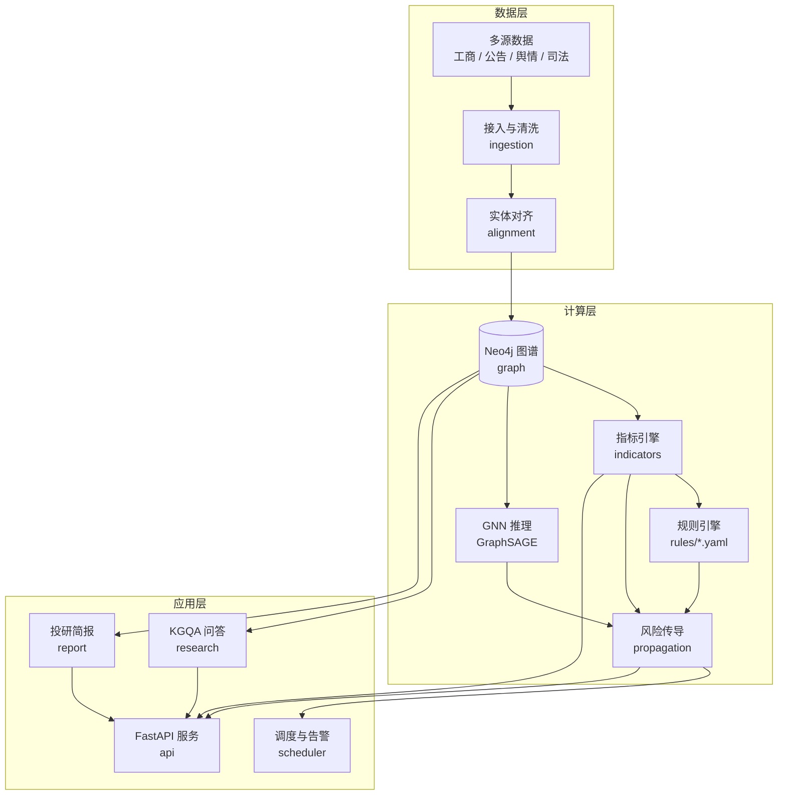

# fin-kg-risk-engine


> 文档语言：中文 | [English](README.en.md)

> 金融知识图谱风险预警与智能投研系统
> 企业级 Python 实现：知识图谱 + 规则引擎 + 图神经网络 + 自然语言投研问答。

把「股权关系错综复杂、底层风险难以穿透」和「投研人员 80% 时间耗在收集数据而非分析上」这两个问题，做成一套可跑、可测、可解释的系统。

---

## 目录

- [它解决什么问题](#它解决什么问题)
- [真实输出](#真实输出)
- [架构](#架构)
- [知识图谱数据模型](#知识图谱数据模型)
- [风险评分与传导](#风险评分与传导)
- [5 分钟快速开始](#5-分钟快速开始)
- [Docker 一键部署](#docker-一键部署)
- [API 文档](#api-文档)
- [项目结构](#项目结构)
- [开发与测试](#开发与测试)
- [设计决策记录](#设计决策记录)
- [能做什么与不能做什么](#能做什么与不能做什么)
- [许可证与贡献](#许可证与贡献)

---

## 它解决什么问题

**问题一：风险穿透。** 一家主体出问题时，真正受影响的往往不是它自己，而是它担保的、它持股的、它控制的一整条链。市面上多数风控系统给出的是「这家公司有 3 条诉讼」，而不是「这家公司倒了会连带谁一起出事」。

本系统给出的答案是：

```
华信控股集团有限公司 -[GUARANTEE]-> 华信置业发展有限公司
                     -[GUARANTEE]-> 华信供应链管理有限公司
                     -[GUARANTEE]-> 中信创业投资有限公司
```

每条路径带传导分与瓶颈系数，分析师知道该看哪一环。

**问题二：投研效率。** 分析师打开一个标的公司，要先去工商查股权、再去公告查担保、再去裁判文书网查涉诉、再去新闻查舆情——80% 的时间花在收集和整理数据。

本系统把「主体概况 / 股权结构 / 担保链 / 风险画像 / 风险传导 / 风险事件 / 可比案例 / 关注要点」组织成一份结构化简报，**每个数字都能回溯到图谱中的具体节点与关系**。

---

## 真实输出

以下输出由本仓库的代码实际产生，不需要数据库、不需要 API Key：

```text
$ fin-kg seed --companies 40 && fin-kg score --limit 5

  42.00  medium   合成28号制造业有限公司
  28.25  low      合成11号建筑工程有限公司
  22.00  low      合成10号贸易有限公司
  12.75  low      合成23号贸易有限公司
   8.25  low      合成12号制造业有限公司

$ fin-kg ingest --source csv && fin-kg ask "华信控股集团有限公司的担保链"

华信控股集团有限公司 共有 7 条担保传导路径，最长 3 跳。示例：华信控股集团有限公司 -> 华信置业发展有限公司（1 跳）；华信控股集团有限公司 -> 华信置业发展有限公司 -> 华信供应链管理有限公司（2 跳）；华信控股集团有限公司 -> 华信置业发展有限公司 -> 华信供应链管理有限公司 -> 中信创业投资有限公司（3 跳）；华信控股集团有限公司 -> 华信置业发展有限公司 -> 恒基建筑工程有限公司（2 跳）；华信控股集团有限公司 -> 华信置业发展有限公司 -> 恒基建筑工程有限公司 -> 远达物流有限公司（3 跳）。

[意图] guarantee_chain  [置信度] 0.90
  · 担保链路径
```

风险分的构成也是透明的 —— 不是黑箱数字：

```text
$ fin-kg report <entity-id>

## 风险画像
恒基建筑工程有限公司 风险分 28.5（medium）。主要来源：强制执行金额占注册资本比 85分×权重0.15（贡献12.8）；对外担保余额占注册资本比 50分×权重0.20（贡献10.0）。

- 涉诉事件数：25 分（权重 0.15，贡献 3.8）
- 强制执行金额占注册资本比：85 分（权重 0.15，贡献 12.8）
- 对外担保余额占注册资本比：50 分（权重 0.20，贡献 10.0）
- 担保链深度：20 分（权重 0.10，贡献 2.0）
```

**诚实提示：** 上面用的是仓库内的**合成样本数据**（`data/samples/`），主体名称均为虚构。示例数据用于演示链路，不是真实市场数据。真实业务数据需自行接入（工商、公告、裁判文书等公开或授权来源）。

---

## 架构



**五层架构，依赖只能向内指：**

| 层 | 模块 | 职责 |
|---|---|---|
| `domain` | 实体 / 关系 / 指标 / 风险 / 溯源 | 纯 Pydantic，零 I/O |
| `graph` | schema / repository / 对齐 / Cypher 库 | 图存储抽象与实体归一 |
| `ingestion` | 源适配 / 清洗 / ETL | 多源数据 → 标准化记录 |
| `risk` | 指标 / 评分 / 规则 / 传导 / GNN | 风险计算全链路 |
| `research` | KGQA / 可比案例 / 简报 | 投研辅助 |
| `api` `scheduler` `observability` | HTTP / 定时 / 监控 | 交付与运维 |

每层都有对应的 ADR，说明为什么这样切。

---

## 知识图谱数据模型

### 节点类型

| 标签 | 关键属性 | 说明 |
|---|---|---|
| `:Company` | `id` `name` `creditCode` `regCapital` `industry` `status` `foundedDate` `region` `riskScore` `riskLevel` | 风险锚点，注册资本统一为**万元** |
| `:Person` | `id` `name` `role` `riskScore` `riskLevel` | 法定代表人 / 董事 / 实控人 |
| `:Event` | `id` `eventType` `severity` `occurredDate` `amount` `court` `caseNumber` `description` | 涉诉 / 执行 / 处罚 / 评级下调等 |
| `:Product` | `id` `productType` `issuerId` `amount` `issueDate` `maturityDate` `couponRate` `rating` | 债券 / 基金 / ABS 等 |

### 关系类型

| 类型 | 方向 | 必填属性 | 传导系数 |
|---|---|---|---|
| `HOLD` | Company → Company | `percent` | 0.90 |
| `GUARANTEE` | Company → Company | `guaranteed_amount` | 1.00 |
| `CONTROLS` | Company → Company | — | 0.95 |
| `LEGAL_REP` | Person → Company | — | 0.80 |
| `DIRECTOR_OF` | Person → Company | — | 0.70 |
| `EMPLOYEE_OF` | Person → Company | — | 0.50 |
| `INVESTED_IN` | Company → Company | — | 0.60 |
| `MERGER_OF` | Company → Company | — | 0.75 |
| `SUPPLIER_OF` / `CUSTOMER_OF` | Company → Company | — | 0.40 |
| `RELATED` | Company → Company | — | 0.30 |
| `INVOLVED_IN` | Company → Event | — | 0.00 |
| `ISSUE` | Company → Product | — | 0.20 |

> 传导系数是风险沿该边传播的强度，也是可解释性的锚点：路径上最弱的一环就是分析师最该看的地方。完整定义见 [`RELATION_SCHEMA`](src/fin_kg/domain/relations.py)。

### 来源溯源

**每一个节点和关系都带溯源**，这不是可选字段：

```json
{
  "sourceType": "registry",
  "sourceId": "csv:companies",
  "recordId": "C001",
  "extractionMethod": "csv_import",
  "confidence": 1.0,
  "retrievedAt": "2026-11-08T10:20:50+08:00",
  "validTime": "2008-03-18",
  "provenanceHash": "9f2c1a7b4d3e8f6051a2b3c4d5e6f708"
}
```

- `confidence` 描述**抽取**置信度，不是源的权威性 —— 人工录入与 LLM 抽取需要不同阈值。
- `retrievedAt` 与 `validTime` 构成双时间模型：平台何时知道 vs 事实何时成立。
- 合成数据的 `sourceType` 恒为 `synthetic`、`confidence` 恒为 0.5，**永远不会被误认为真实数据**。

### 索引策略

| 类型 | 对象 | 用途 |
|---|---|---|
| 唯一约束 | `Company.id` / `Person.id` / `Event.id` / `Product.id` / `Entity.id` | 幂等写入 |
| 唯一约束 | `Company.creditCode` | 实体对齐锚点，防止同一法人多节点 |
| 范围索引 | `HOLD.percent` / `GUARANTEE.guaranteed_amount` | 传导与敞口聚合 |
| 范围索引 | `Event.occurredDate` / `Event.eventType` | 指标窗口扫描 |
| 文本索引 | `Company.name` / `Person.name` / `Product.name` | 名称检索 |
| 范围索引 | `Company.riskScore` / `Company.industry` | 排名与筛选 |

迁移脚本在 [`migrations/`](migrations/)，由 `fin-kg migrate` 幂等应用。

---

## 风险评分与传导

### 10 个风险指标

| ID | 名称 | 维度 | 权重 | 方向 |
|---|---|---|---|---|
| `IND-LIT-001` | 涉诉事件数 | 司法合规 | 0.15 | 越高越险 |
| `IND-ENF-001` | 强制执行金额占注册资本比 | 司法合规 | 0.15 | 越高越险 |
| `IND-PEN-001` | 行政处罚次数 | 司法合规 | 0.10 | 越高越险 |
| `IND-GUA-001` | 对外担保余额占注册资本比 | 财务 | 0.20 | 越高越险 |
| `IND-DEF-001` | 违约事件数 | 财务 | 0.05 | 越高越险 |
| `IND-CHN-001` | 担保链深度 | 传导 | 0.10 | 越高越险 |
| `IND-HLD-001` | 股权集中度 | 治理 | 0.10 | **越低越险** |
| `IND-CTL-001` | 实际控制人风险 | 治理 | 0.05 | 越高越险 |
| `IND-RTE-001` | 评级下调次数 | 市场 | 0.05 | 越高越险 |
| `IND-NEG-001` | 负面舆情热度 | 市场 | 0.05 | 越高越险 |

综合分：`score = Σ(sub_score × weight) / Σ(weight)`，分母用实际权重和，指标增减不会让分数量级跳变。

### 规则引擎

规则是 **YAML**，风控人员可自行调整，无需改 Python：

```yaml
- id: R-CHAIN-001
  name: 担保链传导预警
  severity: critical
  condition:
    all:
      - indicator: IND-CHN-001
        operator: gte
        value: 2
      - path:
          relation_types: [GUARANTEE]
          min_hops: 2
          min_paths: 1
  message: "{entity} 处于多层担保链中（{path_count} 条传导路径），最大受影响方：{path_summary}"
```

支持算子 `gte / gt / lte / lt / eq / neq / between / in`，条件为 AND 语义，**所有命中的规则都会触发**（不是首个命中即停）。

### 风险传导

```
propagated(path) = source_score × Π(transmissibility_i) × decay^(hops-1)
```

默认 `decay = 0.6`，跳数上限 3。乘性衰减保证路径越长分数越低，且**路径本身就是告警的证据**。

### GNN

GraphSAGE 节点分类，**NumPy 完整实现**（前向 + 反向 + 类别加权损失），不依赖 torch 即可训练与推理。CI 因此不需要下载数百 MB 依赖，训练循环也被单元测试真实覆盖。

标签来源支持三种：弱监督（从规则引擎反推）、公开数据集、人工 CSV。

```bash
# 训练（默认用规则引擎做弱监督生成标签）
fin-kg gnn train --model-path data/models/graphsage.json

# 用 CSV 标签训练
fin-kg gnn train --labels data/labels.csv --model-path data/models/graphsage.json

# 加载模型并查看模型分
fin-kg gnn load --model-path data/models/graphsage.json

# 查看模型状态
fin-kg gnn status
```

训练完成后，风险分响应会**同时给出两个分数**（见 [ADR-0004](docs/adr/ADR-0004-risk-scoring-model.md)）：

```json
{
  "score": 37.25,        // 基准分：加权指标综合，风控规则以此为准
  "modelScore": 37.67,   // 模型分：图结构信号；未训练模型时为 null（不是 0）
  "scoreGap": 0.42       // 两者之差；差值大意味着图结构说了指标之外的事
}
```

模型分**不参与**规则阈值判定——融合后的数字不可解释，风控团队会拒绝使用。两个分数并列输出，让模型作为独立信号供人工复核。

### 性能

评分路径的复杂度是 O(企业数)。在 5000 家企业上全量评分约 340ms，10 万家外推约 7 秒。两个手段把它压下来：

- **`?candidates=N`** —— 只对存储风险分最高的 N 个候选重新评分。实测**加速 14 倍，top-5 结果完全一致**（存储分本身就是上一次同样计算写回的）。不传该参数则保持全量评分，排名最准。
- **批量回写** —— 风险分一次性写回图谱，而不是每个主体一次查询。

```bash
curl "http://localhost:8000/api/v1/risk/rank?limit=20&candidates=500"
```

---

## 5 分钟快速开始

### 方式一：零依赖（30 秒）

```bash
git clone https://github.com/Nephets1010/fin-kg-risk-engine.git
cd fin-kg-risk-engine

python -m venv .venv && source .venv/bin/activate    # Windows: .venv\Scripts\activate
pip install -e ".[dev]"

# 用合成数据把整条链路跑通，不需要数据库
fin-kg seed --companies 40
fin-kg score --limit 10
fin-kg ingest --source csv          # 载入仓库内的示例数据集
fin-kg ask "华信控股集团有限公司的担保链"
fin-kg rules
fin-kg schema
```

> 没有 Neo4j 时，平台会把图谱存到 `data/local-graph.json`（一个可读的 JSON 快照），
> 因此**多条 CLI 命令之间数据是共享的**。这不是生产存储，仅用于本地零依赖体验。

### 方式二：Docker Compose（完整栈）

```bash
cp .env.example .env
# 编辑 .env，至少设置 FIN_KG_NEO4J_PASSWORD

docker compose up -d --build
docker compose exec api fin-kg migrate
docker compose exec api fin-kg ingest --source csv

open http://localhost:8000/docs        # 交互式 API 文档
open http://localhost:7474              # Neo4j 浏览器
```

### 方式三：本地开发

```bash
cp .env.example .env
# 启动 Neo4j 与 Redis（docker compose up neo4j redis），然后：
pip install -e ".[dev]"
fin-kg migrate
fin-kg ingest --source csv
fin-kg serve --reload
```

---

## API 文档

完整 OpenAPI 文档在 `/docs`（Swagger UI）与 `/redoc`。以下为核心接口。

### 图谱检索

| 方法 | 路径 | 说明 |
|---|---|---|
| `GET` | `/api/v1/graph/stats` | 节点与关系规模统计 |
| `GET` | `/api/v1/graph/entities?label=Company&limit=20&offset=0` | 分页查询实体 |
| `GET` | `/api/v1/graph/entities/{id}` | 实体详情（含溯源） |
| `GET` | `/api/v1/graph/entities/{id}/neighbourhood?hops=2` | k 跳邻域路径 |
| `GET` | `/api/v1/graph/entities/{id}/paths?source=&target=&hops=4` | 两实体间路径 |

### 风险

| 方法 | 路径 | 说明 |
|---|---|---|
| `GET` | `/api/v1/risk/entities/{id}/score` | 风险分 + 全部指标读数 + 解释 |
| `GET` | `/api/v1/risk/rank?limit=20` | 风险分排名 |
| `GET` | `/api/v1/risk/alerts?min_severity=major&limit=50` | 规则预警列表 |
| `GET` | `/api/v1/risk/entities/{id}/alerts` | 某主体触发的预警 |
| `GET` | `/api/v1/risk/entities/{id}/exposure` | 风险敞口（传导后的受影响主体） |

### 智能投研

| 方法 | 路径 | 说明 |
|---|---|---|
| `POST` | `/api/v1/research/ask` | 自然语言问答（附证据路径） |
| `GET` | `/api/v1/research/similar/{id}?top_k=10` | 结构可比案例 |
| `GET` | `/api/v1/research/report/{id}` | 投研简报（JSON + Markdown） |

### 任务与运维

| 方法 | 路径 | 说明 |
|---|---|---|
| `POST` | `/api/v1/jobs/ingest` | 启动数据接入任务（返回 202 + jobId） |
| `GET` | `/api/v1/jobs/{id}` | 任务状态（轮询） |
| `GET` | `/api/v1/jobs/{id}/result` | 任务结果 |
| `GET` | `/health` `/ready` | 健康与就绪检查 |
| `GET` | `/metrics` | Prometheus 指标 |

**长任务遵循 Init → Step → Poll**（详见 [ADR-0007](docs/adr/ADR-0007-long-running-jobs.md)）。

### 错误信封

所有错误返回统一结构：

```json
{ "code": "not_found", "message": "entity not found", "details": { "entity_id": "X" } }
```

`code` 取自 `fin_kg.core.errors` 的错误分类，HTTP 状态码由分类决定。

### 调用示例

```bash
curl -s http://localhost:8000/api/v1/risk/rank?limit=3 | jq '.items[] | {name: .entityName, score, level}'

curl -s -X POST http://localhost:8000/api/v1/research/ask \
  -H 'Content-Type: application/json' \
  -d '{"question":"华信控股集团有限公司的担保链"}' | jq '{answer, evidence}'
```

---

## 项目结构

```
fin-kg-risk-engine/
├── src/fin_kg/
│   ├── config/          环境驱动的配置（pydantic-settings）
│   ├── core/            日志、错误分类、公共值对象
│   ├── domain/          实体 / 关系 / 指标目录 / 风险对象 / 溯源
│   ├── graph/           schema、repository、实体对齐、Cypher 库
│   ├── ingestion/       源适配器、清洗、ETL 管线
│   ├── risk/            指标引擎、评分、规则、传导、GNN
│   ├── research/        KGQA、可比案例、研报、LLM 客户端
│   ├── api/             FastAPI 应用、路由、schema、任务管理
│   ├── scheduler/       定时任务编排
│   ├── observability/   Prometheus 指标、告警分发
│   ├── cli.py           命令行入口
│   └── worker.py        后台 worker 进程
├── tests/
│   ├── unit/            纯逻辑测试（无外部依赖）
│   └── integration/     API 集成 + Neo4j 集成（自动 skip）
├── docs/
│   ├── adr/             8 篇架构决策记录
│   ├── architecture.md  架构详解
│   ├── api.md           API 详细文档
│   └── deployment.md    部署与运维
├── migrations/          版本化的 Cypher 迁移脚本
├── rules/               风险规则（YAML）
├── data/samples/        示例数据集（合成）
├── scripts/             示例数据生成、压测、密钥检查
├── Dockerfile
├── docker-compose.yml
└── .github/workflows/ci.yml
```

---

## 开发与测试

```bash
make install-dev     # 安装依赖
make test            # 全部测试（211 通过 / 6 跳过）
make test-unit       # 仅单元测试
make coverage        # 覆盖率报告
make lint            # ruff
make typecheck       # mypy
```

测试分三层，这是 ADR-0002 分层架构的直接收益：

| 层次 | 位置 | 需要外部服务 | 数量 |
|---|---|---|---|
| 单元测试 | `tests/unit/` | 否 | 184 |
| API 集成测试 | `tests/integration/test_api.py` | 否（内存图） | 27 |
| Neo4j 集成测试 | `tests/integration/test_neo4j_integration.py` | 是（自动 skip） | 6 |

本地跑 Neo4j 集成测试：

```bash
export FIN_KG_NEO4J_URI=bolt://localhost:7687
export FIN_KG_NEO4J_USER=neo4j
export FIN_KG_NEO4J_PASSWORD=your-password
pytest tests/integration/test_neo4j_integration.py -v
```

### 密钥管理

**仓库里没有任何可用凭证。** 所有敏感配置从环境读取：

```bash
cp .env.example .env
```

`.env` 已被 `.gitignore` 排除；生产模式下若 `FIN_KG_NEO4J_PASSWORD` 为空，服务**拒绝启动**；日志会自动脱敏已注册的密钥；CI 每次推送都会扫描仓库历史里的密钥模式。

---

## 设计决策记录

8 篇 ADR，每篇都写明「为什么这样做、代价是什么、什么情况下撤销」：

| 编号 | 标题 | 一句话结论 |
|---|---|---|
| [0001](docs/adr/ADR-0001-graph-database.md) | 图存储选型 | 变长路径是核心需求，Cypher 与生产迁移路径决定选型 |
| [0002](docs/adr/ADR-0002-layered-architecture.md) | 分层架构 | 依赖只能向内指，domain 层零 I/O |
| [0003](docs/adr/ADR-0003-provenance-model.md) | 溯源模型 | 一等值对象 + 双时间 + 抽取置信度 |
| [0004](docs/adr/ADR-0004-risk-scoring-model.md) | 评分模型 | 基线分与 GNN 分并行输出不融合，指标版本化 |
| [0005](docs/adr/ADR-0005-risk-propagation.md) | 风险传导 | 边传导系数 + 乘性衰减 + 硬跳数上限 |
| [0006](docs/adr/ADR-0006-security-baseline.md) | 安全基线 | 密钥不硬编码 + 标签/关系类型写白名单 + LLM 不生成 Cypher |
| [0007](docs/adr/ADR-0007-long-running-jobs.md) | 长任务接口 | Init → Step → Poll，任务可观测可续跑 |
| [0008](docs/adr/ADR-0008-ci-quality-gates.md) | CI 与质量门禁 | 5 个 job 分层验证，密钥扫描拦截在推送时 |

---

## 能做什么与不能做什么

**能做**

- 多源异构数据 → 统一知识图谱（实体对齐、溯源完整、写入幂等）
- k 跳路径检索与担保链穿透，路径带传导分与瓶颈系数
- 10 指标 + YAML 规则的可解释风险评分，每条预警可回溯到指标读数
- 增量风险传导（只重算受影响邻域）
- GraphSAGE 图分类（NumPy 实现，无需 GPU 即可训练）
- 自然语言投研问答，答案带证据路径
- 结构可比案例检索（说明「哪些维度相似」）
- 结构化投研简报（Markdown / JSON）
- 长任务、Prometheus 指标、告警分发、定时调度

**不能做**

- **不接真实商业数据源**：仓库内只有合成样本与公开接口适配器骨架（Tushare 需自备 token）
- **不提供实时行情与交易**：这是风控预警系统，不是交易系统
- **LLM 默认关闭**：未配置 `FIN_KG_LLM_API_KEY` 时，问答走确定性模板，答案质量以模板为准
- **GNN 精度有限**：训练标签来自弱监督，在真实标注数据上才能给出可信的 F1；仓库不宣称任何未实测的准确率
- **Neo4j Community 单实例**：无高可用，生产规模需 Aura Cloud 或企业版
- **不做实体级权限隔离**：图是全局的，权限控制在 API 层而非图层
- **风控结论需人工复核**：所有输出是辅助材料，不构成投资建议

---

## 许可证与贡献

**代码：[Apache License 2.0](LICENSE)**

**文档与设计（`docs/`、ADR）：[CC BY 4.0](LICENSE-docs)**

这样做是为了让代码可以宽松商用与集成，而设计文档的署名要求能被保留。

贡献请阅读 [CONTRIBUTING.md](CONTRIBUTING.md)。行为准则见 [CODE_OF_CONDUCT.md](CODE_OF_CONDUCT.md)，安全问题请按 [SECURITY.md](SECURITY.md) 私下报告。

---

## 相关文档

- [架构详解](docs/architecture.md) —— 分层、模块边界、数据流
- [API 文档](docs/api.md) —— 全部接口与示例
- [部署与运维](docs/deployment.md) —— Compose / 生产部署 / 监控告警
- [知识图谱数据模型](docs/data-model.md) —— 节点、关系、指标、溯源的完整定义
- [知识图谱数据模型（English）](docs/data-model.en.md) —— 同一文档的英文版
- [技术债台账](docs/technical-debt.md) —— 已知问题、处置记录与待确认项
